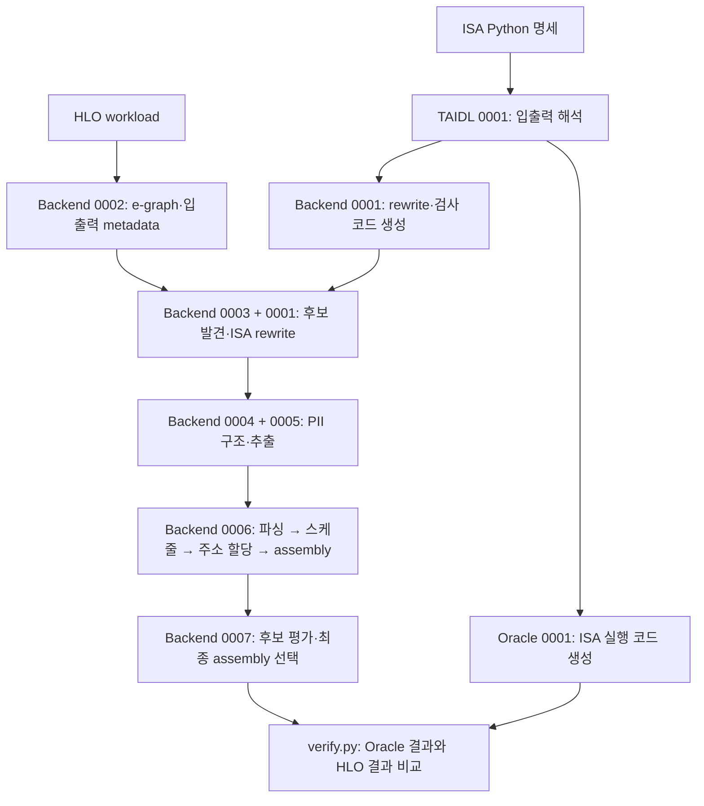

# ACT Multi-Result

ACT PLDI 튜토리얼처럼 **ISA Python 실행 → 생성된 backend로 HLO 컴파일 → Oracle 실행**
순서로 사용한다. QKV는 기존 단일 출력 ACT를, DoubleGEMM은 다중 출력 확장을 살펴보는 예제다.
Linux·Conda 환경을 사용하며 Oracle은 CPU에서 실행한다.

## 1. 설치와 ACT 소스 준비

```bash
git clone --recurse-submodules https://github.com/jihwan38/act-multi-result.git
cd act-multi-result
./scripts/setup.sh

# conda activate가 동작하지 않으면 먼저 설치 위치의 conda.sh를 불러온다.
# Miniforge 기본 경로: source ~/miniforge3/etc/profile.d/conda.sh
conda activate act

python scripts/prepare_sources.py baseline
source scripts/env.sh baseline
```

`setup.sh`는 고정 upstream을 내려받고, `act` Conda 환경을 생성하거나 `environment.yml`에 맞춰 갱신하며,
ACT Python 패키지와 로컬 OR-Tools를 설치한다. ISA별 compiler는 아직 만들지 않는다.
NumPy 1.26.4, JAX·jaxlib 0.4.33, ml-dtypes 0.4.1을 고정하고 설치 후 버전과 JAX CPU 초기화를 확인한다.
OR-Tools에서는 ACT가 사용하는 constraint solver를 빌드하며, 선택적인 SCIP·COIN-OR·HiGHS 연계는 끈다.
처음 실행할 때는 native 의존성 빌드에 시간이 걸린다.

환경 이름은 `ACT_ENV_NAME=act-dev ./scripts/setup.sh`, Conda 경로는
`ACT_CONDA_EXE=/path/to/conda ./scripts/setup.sh`, 빌드 병렬도는 `ACT_BUILD_JOBS=4`로 지정한다.
스크립트가 끝난 뒤 현재 터미널에서 `conda activate act`를 실행해야 한다.

그다음 두 명령의 역할은 서로 다르다.

- `prepare_sources.py baseline`: `third_party/`의 고정 소스를 `build/baseline/src/`로 복사하고 `patches/baseline/`의 기본 수정 패치를 적용한다.
- `source scripts/env.sh baseline`: 현재 셸의 `PYTHONPATH`가 그 소스를 가리키게 하고 native 라이브러리 경로를 설정한다. 생성 위치인 `ACT_BUILD_DIR`도 `build/baseline`의 절대 경로로 설정한다. 파일 생성이나 컴파일은 하지 않는다.

## 2. QKV ISA를 실행해 compiler와 Oracle 만들기

[QKV.py](cases/qkv/QKV.py)는 [원본 튜토리얼 QKV.py](third_party/act/tutorials/pldi26/exercise3/solution/QKV.py)의
데이터 모델과 7개 명령 선언을 그대로 사용한다. 저장소의 `build/` 아래에 생성하도록
`Accelerator`의 기존 `base_dir` 인자를 지정한 것이 사용 경로상의 차이다.

```bash
python cases/qkv/QKV.py
```

파일에는 `qkv = Accelerator(...)`, `add_data_model(...)`, `add_instruction(...)`와
각 명령의 `set_inputs()`, `set_outputs()`, `add_semantics()`가 차례로 나온다.
끝부분에서는 ACT의 생성기를 직접 호출한다.

```python
if __name__ == "__main__":
    generate_oracle(qkv)
    generate_backend(qkv)
```

`python QKV.py`로 실행하면 두 호출이 수행된다. 테스트에서 명세를 import하면 선언만 읽는다.
`generate_oracle()`은 API·기능 시뮬레이터를 생성하고 native 모듈을 빌드하며,
`generate_backend()`는 해당 ISA용 Rust·C++ 소스를 생성하고 compiler 실행 파일까지 빌드한다.

| 생성물 | 위치 (`$ACT_BUILD_DIR` = `build/baseline`의 절대 경로) |
| --- | --- |
| Oracle API | `$ACT_BUILD_DIR/targets/QKV/oracle/api.py` |
| Oracle runtime | `$ACT_BUILD_DIR/targets/QKV/oracle/decorator.py` |
| Backend 소스 | `$ACT_BUILD_DIR/targets/QKV/backend/` |
| IR→ISA rewrite 규칙 | `$ACT_BUILD_DIR/targets/QKV/backend/src/isel/rewrites/ir2isa_rewrites.txt` |
| Compiler 실행 파일 | `$ACT_BUILD_DIR/backends/QKV` |

ISA 파일을 수정했다면 같은 Python 명령을 다시 실행한다. ACT 생성기는 해당 target의
`backend/`·`oracle/` 생성 소스를 다시 만든다. 직접 수정해 보존할 코드는 이 생성 디렉터리에 두지 않는다.

## 3. 생성된 backend로 HLO 컴파일하기

이제 ISA 명세로 만든 compiler에 [attention.hlo](cases/qkv/workloads/attention.hlo)를 입력한다.
아래 명령은 ACT backend 실행 파일의 실제 CLI다.

```bash
mkdir -p "$ACT_BUILD_DIR/runs/qkv/attention"

"$ACT_BUILD_DIR/backends/QKV" \
  --input cases/qkv/workloads/attention.hlo \
  --output "$ACT_BUILD_DIR/runs/qkv/attention/assembly.py" \
  --log "$ACT_BUILD_DIR/runs/qkv/attention/compiler"
```

`--input`은 계산할 HLO, `--output`은 최종 assembly 파일, `--log`는 탐색 중 만든
PII·후보 assembly·metadata를 저장할 디렉터리다. 이 위치들은 CLI로 직접 정한다.
`runs/qkv/attention`은 이 README에서 사용한 정리 방식이며 compiler의 필수 폴더 규칙은 아니다.

Compiler는 기존 `--output` 파일을 덮어쓰고 **`--log` 디렉터리는 지운 뒤 다시 만든다.**
로그 전용 디렉터리를 지정한다.

## 4. Oracle로 assembly 실행하기

```bash
python scripts/verify.py \
  --hlo cases/qkv/workloads/attention.hlo \
  --assembly "$ACT_BUILD_DIR/runs/qkv/attention/assembly.py"
```

[verify.py](scripts/verify.py)는 workload와 assembly 경로를 받아 검증하는 공통 스크립트다.
위 명령의 두 경로를 바꾸면 다른 workload도 같은 명령으로 검증할 수 있다.
기본 `build/<구성>/runs/<case>/...` 경로에서는 그 case에 맞는 Oracle을 찾는다.
코드 안에서는 다음 ACT API를 호출한다.

```python
from oracle import api
from oracle.decorator import kernel, set_simulation_backend

set_simulation_backend("CPU")
factory, metadata, calls = load_assembly(args.assembly)
program = factory(kernel, api)
program("fsim-compile")()
outputs, elapsed = program("fsim")(*inputs)
```

`load_assembly()`는 앞에서 만든 Python assembly 파일을 읽어 그 안의 함수를 반환한다.
`factory(kernel, api)`가 생성된 API와 Oracle runtime을 연결하고, `fsim-compile`이 시뮬레이션을
준비한다. `fsim`에는 실제 입력 배열을 넘긴다.

검증 코드는 같은 입력을 **원래 HLO 그대로 XLA CPU에서 실행한 결과**와 비교한다.
난수 seed 0·1·2와 zero 입력에 대해 출력 개수·shape·dtype·bytes가 일치하는지 확인한다.
튜토리얼의 `.dat` 정답 파일은 사용하지 않는다. 결과는 assembly 옆의 `verification.json`에
기록하며 `--report`로 바꿀 수 있다. 보고서에는 출력별 실제·기준 shape와 dtype, 바이트 일치 여부,
최대 절대 오차를 남긴다. 입력 파일이 없거나 Oracle 지정이 잘못된 경우에도 이전 PASS 보고서를
실패 기록으로 바꾼다. 보고서 경로로 입력 파일을 지정하는 것은 거절한다.

Assembly를 다른 디렉터리에 저장했다면 사용할 Oracle도 지정한다.
Assembly 자체에는 ISA 이름이 없으므로 명령어 이름만 보고 Oracle을 추측하지 않는다.

```bash
python scripts/verify.py \
  --hlo cases/qkv/workloads/attention.hlo \
  --assembly /path/to/assembly.py \
  --oracle "$ACT_BUILD_DIR/targets/QKV/oracle"
```

## 5. 다중 출력 ACT와 DoubleGEMM

먼저 사용할 ACT 소스를 전환한다. Conda 환경은 그대로 사용한다.

```bash
python scripts/prepare_sources.py multi-result
source scripts/env.sh multi-result
```

| 구성 | 적용 소스 | 생성 위치 |
| --- | --- | --- |
| `baseline` | 고정 upstream + `patches/baseline/` | `build/baseline/` |
| `multi-result` | 같은 upstream + `patches/baseline/` → `patches/multi-result/` | `build/multi-result/` |

`patches/baseline/`은 두 구성 모두에 적용하는 기본 수정이다. native 의존성 경로,
명시적 HLO ROOT 처리, 선언한 주소 제약 적용, Oracle broadcast를 수정한다.
수정하지 않은 upstream은 `third_party/`에 보관한다.

다중 출력 ACT에서도 같은 `python cases/qkv/QKV.py`를 실행할 수 있다. 이어서 3·4절 명령을
그대로 실행하면 같은 QKV ISA·HLO를 이번에는 `build/multi-result/`에서 생성·컴파일·검증한다.

[QKVDoubleGemm.py](cases/double_gemm/QKVDoubleGemm.py)는 튜토리얼 QKV를 다음과 같이 확장한다.

| 부분 | 튜토리얼 QKV | DoubleGEMM 예제 |
| --- | --- | --- |
| 데이터 모델 | D1=128행, D2=64행 | lane마다 같은 용량의 D1·D2, HBM은 공유 |
| 기존 명령 | load_rm, load_cm, store_rm, store_cm, mov, gemm, softmax | 각각 `_0`, `_1` 두 벌 |
| 크기·주소 속성 | `n`, `addr_in`, `addr_out` 등 | 기존 7개 명령에서는 그대로 유지 |
| softmax 주소 | 입력·출력이 같은 `addr` | 각 lane에서도 그대로 유지 |
| 추가 명령 | — | `double_gemm`, `join_store` |

총 16개 명령이다. `double_gemm`은 네 입력으로 GEMM 두 개를 계산해 각 lane의 D2에 결과를
하나씩 쓴다. TAIDL semantic의 마지막 `ROOT ... tuple(%left, %right)` 순서가
`set_outputs()`의 두 결과 순서에 대응한다. `join_store`는 D2 두 결과를 세로로 이어 붙여
HBM으로 저장한다. 기본 HLO의 두 dot과 concatenate를 이 명령들로 구현할 수 있다.

튜플은 값의 묶음이며 독립성을 뜻하지 않는다. DoubleGEMM 후보를 넣는 과정과 ISA rewrite가
명세에 맞는 입력 조합을 검사한다. 서로 의존하는 GEMM은 같은 DoubleGEMM으로 선택할 수 없다.

직접 실행하는 명령은 QKV와 같다.

```bash
python cases/double_gemm/QKVDoubleGemm.py
mkdir -p "$ACT_BUILD_DIR/runs/double_gemm/two_gemm_concat"

"$ACT_BUILD_DIR/backends/QKVDoubleGemm" \
  --input cases/double_gemm/workloads/two_gemm_concat.hlo \
  --output "$ACT_BUILD_DIR/runs/double_gemm/two_gemm_concat/assembly.py" \
  --log "$ACT_BUILD_DIR/runs/double_gemm/two_gemm_concat/compiler"

python scripts/verify.py \
  --hlo cases/double_gemm/workloads/two_gemm_concat.hlo \
  --assembly "$ACT_BUILD_DIR/runs/double_gemm/two_gemm_concat/assembly.py"
```

DoubleGEMM도 같은 `verify.py`를 사용한다. `multi-result` 구성의 QKV·DoubleGEMM 기본 run 경로에서는
compiler가 쓴 `assembly.py.allocation.json`과 선택된 PII를 ISA 선언에 대조해
결과 port·주소 범위·수명 충돌을 검사한다. 일반 검증은 특정 명령의 호출 횟수를 요구하지 않는다.
개별 GEMM으로 구현된 assembly도 계산과 주소가 올바르면 통과한다.

## 6. 다른 HLO를 실행하기

ISA가 바뀌지 않았다면 이미 만든 compiler에 다른 `--input`을 넘기면 된다.
아래는 의존하는 두 GEMM이 있는 기존 테스트 HLO를 사용하는 예다.

```bash
mkdir -p "$ACT_BUILD_DIR/runs/double_gemm/dependent_tuple"

"$ACT_BUILD_DIR/backends/QKVDoubleGemm" \
  --input tests/fixtures/dependent_tuple.hlo \
  --output "$ACT_BUILD_DIR/runs/double_gemm/dependent_tuple/assembly.py" \
  --log "$ACT_BUILD_DIR/runs/double_gemm/dependent_tuple/compiler"

python scripts/verify.py \
  --hlo tests/fixtures/dependent_tuple.hlo \
  --assembly "$ACT_BUILD_DIR/runs/double_gemm/dependent_tuple/assembly.py"
```

새 파일을 `cases/double_gemm/workloads/my_workload.hlo`에 만들었다면 위의 입력·출력 경로를
그 이름에 맞게 바꾸면 된다. 별도 케이스 등록 파일은 필요 없다.
로그를 다른 위치에 저장했다면 검증 시 `--pii /path/to/선택된번호.pii`를 넘긴다.
선택된 번호는 assembly의 `# PII number:`에 적혀 있다.
임의 경로에 둔 assembly에도 주소 검사를 수행하려면 `--oracle`과 함께 ISA·PII를 지정한다.
할당 기록은 `<assembly 경로>.allocation.json`에 있어야 한다.

```bash
python scripts/verify.py \
  --hlo cases/double_gemm/workloads/two_gemm_concat.hlo \
  --assembly /path/to/assembly.py \
  --oracle "$ACT_BUILD_DIR/targets/QKVDoubleGemm/oracle" \
  --isa cases/double_gemm/QKVDoubleGemm.py \
  --pii /path/to/selected.pii
```

## 폴더와 패치의 역할

```text
cases/
  qkv/                 QKV.py, workloads/attention.hlo
  double_gemm/         QKVDoubleGemm.py, workloads/two_gemm_concat.hlo
patches/
  baseline/            기본 수정 패치 + series; 두 구성 모두에 적용
  multi-result/        다중 출력 패치 + series
third_party/           고정 upstream submodule 4개
scripts/
  setup.sh             Conda 환경·ACT 패키지·OR-Tools 설치
  prepare_sources.py   upstream 복사와 패치 적용
  env.sh               준비된 ACT 소스를 현재 셸에서 사용
  verify.py            HLO와 assembly를 받아 Oracle 검증
  run.sh               ISA 생성·HLO 컴파일·검증을 묶은 선택 명령
  test.sh              회귀 테스트 실행
  _internal/           위 명령이 사용하는 공통 코드·설치 보조 도구
tests/                 Python·Rust 회귀 테스트와 테스트 전용 HLO
build/                 생성된 소스·compiler·assembly·검증 결과; Git 제외
```

로컬 보고서와 그림을 보관하는 `docs/`도 Git에서 제외한다. 위 실행 경로는 이 디렉터리의
파일을 사용하지 않는다.

패치의 하위 폴더는 **실제 수정할 upstream 저장소**를 뜻하고, 번호는 그 저장소 안의 적용 순서다.
명세를 읽는 첫 단계는 세 저장소에 걸쳐 있으므로 각각 `0001`이 있다. 역할을 구분할 수 있도록
파일명도 아래처럼 나눴다.

| 패치 | 수정하는 코드와 역할 |
| --- | --- |
| [TAIDL 0001 — semantic-interface](patches/multi-result/taidl/0001-semantic-interface.patch) | tuple 반환 문법과 `semantic_interface()`. `parameter(index)`로 입력 순서, ROOT tuple로 결과 순서를 읽고 개수·타입을 확인한다. |
| [Backend 0001 — isa-rewrites](patches/multi-result/act-backend/0001-isa-rewrites.patch) | 그 입출력 해석을 받아 `lower_semantics()`로 계산식을 읽고, IR→ISA 규칙·타입/shape 검사·외부 입력 검사를 생성한다. |
| [Oracle 0001 — isa-codegen](patches/multi-result/act-oracle/0001-isa-codegen.patch) | 같은 입출력 해석을 받아 `generate_inputs()`·`generate_outputs()`가 Oracle의 읽기·결과 저장 코드를 생성한다. |

입출력 순서를 정하는 함수는 TAIDL에 한 번 정의하며 Backend와 Oracle이 함께 호출한다.
Backend는 **어떤 계산을 ISA로 바꿀 수 있는지**, Oracle은 **그 ISA를 실행했을 때 어떤 값이
나오는지**를 담당하므로 두 생성기의 출력물은 서로 다르다.

다중 출력 Backend의 7개 패치는 다음 흐름으로 이어진다.

| 단계 | 패치 | 책임과 주요 코드 |
| --- | --- | --- |
| ISA 규칙 준비 | [0001-isa-rewrites](patches/multi-result/act-backend/0001-isa-rewrites.patch) | `semantics.py`, rewrite 생성기, `applier.rs`, `joint.rs`. 규칙에 필요한 `TensorOp` tuple/GTE와 tensor 정보 처리도 포함한다. |
| HLO 입력 처리 | [0002-hlo-tuples](patches/multi-result/act-backend/0002-hlo-tuples.patch) | `initializer/`, `ir/value.rs`, `metadata.rs`. HLO tuple/GTE를 읽고 프로그램의 입력·반환 구조와 HBM 위치를 만든다. |
| ISA 후보 발견 | [0003-isa-candidates](patches/multi-result/act-backend/0003-isa-candidates.patch) | `discovery.rs`와 Runner hook. 결과별 매칭을 다시 찾아 적합한 조합에 tuple/GTE를 추가한다. ISA 노드는 0001의 rewrite로 추가한다. |
| PII 표현 | [0004-pii-model](patches/multi-result/act-backend/0004-pii-model.patch) | `BufferSignature`, `ValueRef`, `PiiResult`, `PiiGraph`. 명령어 하나의 여러 결과, 소비자의 결과 참조, 프로그램 출력을 기록한다. |
| PII 추출 | [0005-pii-extraction](patches/multi-result/act-backend/0005-pii-extraction.patch) | `extractor/fast.rs`, `slow.rs`, `utils.rs`. 요구한 값의 생산자·결과를 선택하고, 재사용과 실패 시 복구를 처리한다. |
| PII → assembly | [0006-pii-to-assembly](patches/multi-result/act-backend/0006-pii-to-assembly.patch) | C++ parser·Instruction/Tensor·scheduler·allocator·emitter와 생성기. 결과별 주소·수명을 계산해 호출문과 할당 기록을 쓴다. |
| 최종 후보 선택 | [0007-candidate-evaluation](patches/multi-result/act-backend/0007-candidate-evaluation.patch) | `pipeline.rs`의 종료 판단. 받은 PII batch에 미평가 후보가 있으면 ‘개선 없음’ 중단을 보류하며 전체 시간 제한은 유지한다. |

Oracle의 [0002-hlo-tuples](patches/multi-result/act-oracle/0002-hlo-tuples.patch)는 생성된 kernel의
입력 tuple을 tensor 목록으로 펼치고 결과를 원래 tuple 구조로 복원한다. ISA 한 명령어의 결과
port 순서를 다루는 Oracle 0001과 구분한다.



패치 경계는 각 기능이 다음 단계에 넘기는 정보를 기준으로 정했다. `pipeline.rs`는 여러 단계를
연결하므로 여러 패치가 수정한다. 0002는 입출력 metadata, 0003은 발견 hook, 0005는 추출기의
입력 인자, 0006은 C++ 호출·산출물 전달, 0007은 종료 조건을 바꾼다.

0001의 `initializer` 수정은 생성한 의미 검사와 workload의 연산 정보를 맞추기 위한 것이다.
scalar의 빈 shape, broadcast의 `dimensions`, multiply의 IR 처리가 여기에 포함된다.
HLO의 중첩 tuple·프로그램 입출력 구조를 읽는 기능은 0002에 둔다. Oracle 0001에도 명세 본문의
concatenate와 scalar를 실행 코드로 만드는 수정이 포함된다.

0004의 fast/slow 수정은 새 자료구조를 기존 단일 출력 추출기에 연결하는 부분이다.
다중 결과를 따라가는 탐색은 0005에 있다. 0004에서 넣은 임시 차단은 아직 구형인 C++ allocator에
다중 출력 PII를 넘기지 않도록 하며, C++ 지원을 완성하는 0006이 제거한다.
0006은 PII의 여러 결과를 C++에서 읽어 assembly까지 보존하는 범위여서 parser·scheduler·emitter도
함께 수정한다.

공통 외부 입력 검사는 0001의 `joint.rs`에 정의하고 0003도 그 구현을 호출한다. 후보를 처음 찾을 때의
선별과 실제 ISA rewrite가 매칭한 조합의 검사는 각각 수행한다. e-graph가 바뀌거나 workload에서
tuple이 직접 들어오는 경우에도 현재 매칭을 확인해야 하기 때문이다.

각 구성의 `series`에 적용할 파일과 저장소별 순서를 적는다.
소스 준비 스크립트는 해당 upstream 복사본에만 그 패치를 적용한다.
`build/<구성>/src/provenance.json`에는 upstream revision·패치 hash를 기록한다.
준비된 소스를 직접 수정했으면 `prepare_sources.py`는 덮어쓰지 않고 멈춘다.
변경을 패치로 보존한 뒤 재생성한다. `--force`는 해당 구성의 준비된 소스를 교체한다.

## 선택 사항: 명령 묶어서 실행하기와 회귀 테스트

직접 명령을 확인한 뒤에는 아래 보조 스크립트로 같은 과정을 한 번에 실행할 수 있다.
`run.sh`는 소스 준비 → **위 ISA Python 실행** → backend 호출 → **verify.py 실행**을 수행한다.

```bash
./scripts/run.sh qkv
./scripts/run.sh qkv --toolchain multi-result
./scripts/run.sh double_gemm

# ISA Python에서 이미 compiler와 Oracle을 생성했다면 재사용
./scripts/run.sh double_gemm --skip-build
./scripts/run.sh double_gemm --skip-build --workload tests/fixtures/dependent_tuple.hlo

./scripts/test.sh --unit-only
./scripts/test.sh
```

보조 스크립트는 `build/<구성>/runs/<case>/<HLO파일명>/assembly.py`에 결과를 둔다.
같은 경로로 재실행하면 assembly·검증 결과와 compiler 로그를 갱신한다.
`run.json`은 실행 기록, `selected.pii`는 선택된 PII의 복사본이다.
ISA를 바꿨으면 먼저 ISA Python을 다시 실행하거나 `--skip-build`를 빼고 실행한다.
Compiler와 Oracle만 만들려면 5절처럼 `source scripts/env.sh multi-result` 후
`python cases/double_gemm/QKVDoubleGemm.py`를 실행한다.

`scripts/` 최상위의 여섯 파일이 사용자가 실행하는 명령이다. `_internal/`에는 이 명령들이
공유하는 환경·경로 처리, assembly 파싱·주소 검사, `run.sh`·`test.sh`의 Python 구현,
`setup.sh`가 호출하는 설치 도구를 둔다. 실습 중 이 내부 파일을 직접 실행할 필요는 없다.

회귀 테스트는 튜토리얼 ISA 보존, Python 생성기, 세 기본 실행 조합, 검증 CLI의 실패 처리와 결과 순서 비교, 의존성 있는 GEMM의
결합 거절, 잘못된 할당 기록의 거절, Rust의 tuple·반환값·후보 발견을 검사한다.
기본 예제가 DoubleGEMM을 선택하는지 확인하는 것은 이 회귀 테스트에 포함한다.
결과는 `build/checks/tests/summary.json`에 남는다.

`tests/test_*.py`는 명세 해석·생성기·공개 ISA·metadata를 검사한다. 서로 다른 연산·타입·크기의
출력을 갖는 작은 ISA는 필요한 테스트 안에서 선언해 생성기로 확인한다. `tests/check_*.py`는
실제로 생성된 assembly를 사용해 검증 CLI와 주소 검사의 실패 처리를 확인한다.
`tests/rust/`는 생성된 backend의 추출·rewrite를 검사하고, `tests/fixtures/`의 HLO 다섯 개는
의존성·tuple 반환·GTE 테스트 입력이다. 회귀 테스트 전체를 실행하면 이들을 함께 사용한다.

검증 프로그램은 현재 예제의 flat tensor 입력과 straight-line assembly를 대상으로 한다.
주소 검사는 1차원 버퍼와 이 ISA의 정수 길이 표현을 지원한다. 더 큰 workload는 ACT의
탐색 제한 내에서 assembly를 찾지 못할 수 있다. 비용모델의 줄 수 비교와 CPU Oracle 검증은
가속기 성능 측정이 아니다.

Upstream: [ACT](https://github.com/act-compiler/act),
[TAIDL](https://github.com/act-compiler/taidl),
[ACT Backend](https://github.com/act-compiler/act-backend),
[ACT Oracle](https://github.com/act-compiler/act-oracle).
