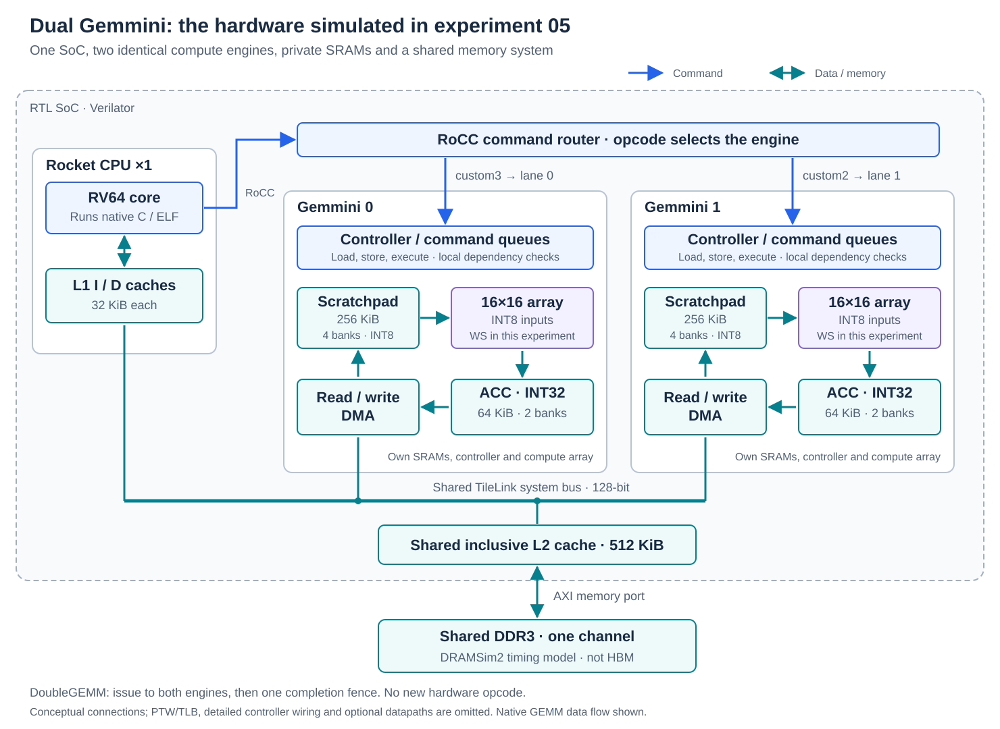

# ACT에서 실제 Gemmini까지

`cases/gemmini`의 `multi-result-legacy` 구성에 대한 설명이다.
원래 `act-parallelism` 실험 05의 계산·하드웨어 구성을 유지한다.

## 하드웨어

현재 구성은 **Rocket CPU 1개 + 동일한 Gemmini 2개 + 공유 L2·DDR3**다.
CPU와 두 엔진을 하나의 SoC RTL로 Verilator에서 실행하고, 외부 메모리의
타이밍은 DRAMSim2로 시뮬레이션한다.

### 공식 Gemmini 그림과의 관계

아래는 실험에서 고정한 upstream revision의 공식 구조도다.


출처: [ucb-bar/gemmini README와 Architecture 설명](https://github.com/ucb-bar/gemmini/blob/25809f78323a729ef76fb68f3cedd8a24da2942b/README.md#architecture).
위 그림은 공식 **단일 엔진** 그림이며, 05의 두 엔진 구성 자체를 그린 것은 아니다.

05에서는 그림 오른쪽의 **Gemmini Accelerator 블록을 두 벌** 둔다.
각 블록은 자기 controller·명령 큐·DMA·scratchpad·accumulator·systolic array를
갖는다. 반면 Rocket CPU, CPU의 L1 캐시, 공유 L2와 메인 메모리는 두 벌로
복제하지 않는다. 공식 그림의 PTW/TLB 같은 세부 연결은 아래 요약도에서 생략한다.

[ActGemminiConfigs.scala](../hardware/ActGemminiConfigs.scala)의
`ActDualGemminiRocketConfig`가 `DefaultGemminiConfig`를 두 번 추가하고,
`WithNHugeCores(1)`로 CPU 하나를 구성한다. `use_shared_ext_mem = false`는
**두 Gemmini의 로컬 SRAM을 공유하지 않는다**는 설정이지, 메인 메모리를
공유하지 않는다는 뜻이 아니다.

아래는 이 설정과 생성된 RTL의 캐시 구성을 반영해 직접 그린 05 구성도다.
파란 선은 명령 전달, 청록색 선은 데이터 이동·공유 메모리 접속을 나타낸다.
Gemmini 내부의 화살표는 현재 native GEMM에서 사용하는 데이터 흐름이며,
전체 RTL 배선을 빠짐없이 그린 회로도는 아니다.



[SVG 원본](images/dual-gemmini-system.svg)은 확대하거나 직접 편집할 수 있다.

### 명령 경로: 어느 엔진에 무엇을 시키는가

```text
ACT Python assembly
  -> emit_native.py: C 호출로 lowering
  -> RISC-V ELF
  -> 시뮬레이션 안의 Rocket CPU가 실행
       |
       v
  RoCC command router
       +-- opcode custom3 --> Gemmini 0 controller / 명령 큐
       +-- opcode custom2 --> Gemmini 1 controller / 명령 큐
```

RoCC는 Rocket과 가속기 사이의 명령 인터페이스다. `custom3`와 `custom2`는
RISC-V의 사용자 정의 명령용 opcode이며, 여기서는 목적지 엔진을 구분한다.
숫자 3·2가 lane 번호이거나 서로 다른 GEMM 알고리즘이라는 뜻은 아니다.
명령 안의 `funct` 필드가 `mvin`, `preload`, `compute_preloaded`, `mvout`
등 실제 작업을 구분한다.

[gemmini_dual.h](../native/gemmini_dual.h)의 `act_issue(lane, func, rs1, rs2)`는
lane 0이면 custom3, lane 1이면 custom2를 사용한다. 하드웨어에서는
[LazyRoCC.scala의 RoccCommandRouter](https://github.com/chipsalliance/rocket-chip/blob/72690b07c0939a58670418b97e5442835b2049b5/src/main/scala/tile/LazyRoCC.scala#L400)가
opcode를 보고 해당 엔진으로 명령을 전달한다. CPU가 계산을 대신하는 것이
아니라, 각 Gemmini가 받아 둔 명령을 자기 연산기로 실행한다.

### 데이터 경로: 무엇이 전용이고 무엇이 공유인가

위 SVG의 공유 메모리 접속선에는 데이터가 양방향으로 흐른다. Gemmini의 DMA는
CPU L1을 거치지 않고 공유 메모리 연결망에 접속한다. CPU가 데이터를 한 원소씩
가속기에 전달하는 구조가 아니다. L2 hit이면 DDR3까지 내려가지 않을 수 있으며,
두 엔진의 DMA와 CPU는 공유 경로의 대역폭을 경쟁한다.

각 Gemmini 내부는 [GemminiConfigs.defaultConfig](https://github.com/ucb-bar/gemmini/blob/25809f78323a729ef76fb68f3cedd8a24da2942b/src/main/scala/gemmini/Configs.scala#L20)를
사용한다.

- **16×16 systolic array**: INT8 입력의 행렬곱을 수행한다. 하드웨어는 OS/WS를
  지원하지만, 현재 native 프로그램은 WS(weight-stationary)로 설정한다.
- **SP 256 KiB, 4 banks**: 입력 행렬을 두는 전용 scratchpad SRAM이다.
- **ACC 64 KiB, 2 banks**: INT32 누산값·결과를 두는 전용 accumulator SRAM이다.

현재 GEMM의 데이터 이동은
`공유 메모리 → DMA → SP → 연산기 → ACC → DMA → 공유 메모리`다.
`GemminiDual.py`의 `sp_0/acc_0`은 첫 엔진의 SRAM,
`sp_1/acc_1`은 둘째 엔진의 SRAM에 대응한다. 이 실험의 native 경로는 한 엔진의
결과를 다른 엔진에 넘길 때도 메인 메모리에 저장한 뒤 다시 적재한다.

공유 캐시·연결망은 Chipyard의
[AbstractConfig](../../../third_party/chipyard/generators/chipyard/src/main/scala/config/AbstractConfig.scala)의
`WithInclusiveCache`와 `WithCoherentBusTopology`에서 온다. 위 캐시 크기는
실제 생성된 다음 DTS의 `i-cache-size`, `d-cache-size`, L2 `cache-size`와도
대조했다.

```text
build/multi-result-legacy/hardware/chipyard/sims/verilator/generated-src/
  chipyard.harness.TestHarness.ActDualGemminiRocketConfig/
    chipyard.harness.TestHarness.ActDualGemminiRocketConfig.dts
```

메인 메모리는 **HBM이 아니라 DDR3 모델**이다. ACT의 `d0`/`Buffer::HBM`은
여기서 공유 메인 메모리를 가리키는 논리적 이름이다.
[run_native.sh](../hardware/run_native.sh)는 `+dramsim`으로 이 모델을 켠다.
실제 로그에 CPU 500 MHz, DRAM 666,666,666 Hz가 기록되지만, 이는 시뮬레이션
설정이지 합성·배치배선으로 입증한 동작 주파수가 아니다. 두 엔진을 따로
시뮬레이션한 시간을 합친 것도 아니다.

`third_party/chipyard`의 gitlink가 Chipyard를 고정하고, 하위 Gemmini·Rocket·tests는
각 부모 저장소의 gitlink로 고정한다. `hardware/source_tree.py`가 작업본과
대조한다. `hardware/versions.json`은 firtool과 공식 Conda lock을 고정한다.
개발용 ACT Conda 환경은 별도로 유지한다.

## ISA의 정확한 범위

`GemminiDual.py`의 data model과 `native/gemmini_dual.h`의 구현은 다음 계약을 갖는다.
주소는 ACT가 생성한 assembly의 값을 그대로 쓴다.

| ACT 명령 | 입력 → 출력 | 실제 native 명령 |
|---|---|---|
| `mvin_N` | DRAM 256 bytes → SP 16 rows | `mvin`, 완료 fence |
| `gemm_N` | SP의 INT8 행렬 두 개 → ACC 16 rows | WS `preload` + `compute_preloaded`, fence |
| `double_gemm` | 각 SP의 행렬 두 개 → 각 ACC의 독립 결과 | 두 preload, 두 compute, 마지막에 fence |
| `mvout_N` | ACC 16 rows → DRAM 1024 bytes | full-width accumulator `mvout`, fence |
| `requantize_store_N` | ACC 16 rows → DRAM 256 bytes | INT8 saturating `mvout`, fence, stride 복원 |

SP 주소 단위는 16-byte row, ACC 주소 단위는 64-byte row다. 예를 들어
`double_gemm(..., o0=0, o1=0)`은 같은 메모리에 두 번 쓰는 것이 아니라
**lane 0 ACC의 row 0과 lane 1 ACC의 row 0**에 각각 쓴다. Tuple은 이 두
논리적 결과를 표현할 뿐, 별도의 tuple 하드웨어나 붙어 있는 SRAM을 요구하지 않는다.

Native accumulator 주소 bit 31은 accumulator 선택, bit 30은 누산 여부,
bit 29는 full-width 읽기다. GEMM은 bit 30을 0으로 하여 기존 ACC 값을 덮어쓴다.
정수 출력은 bit 29를 1로 하여 INT8 축소 없이 읽는다.

`requantize_store`의 의미는 `convert_s8(min(max(x, -128), 127))`다.
이는 단순 `convert_s8(x)`의 wraparound와 다르다. Native 저장은 identity
scale과 포화를 사용하고, DRAM row stride를 16 bytes로 바꾼 뒤 기존
INT32 저장용 64 bytes로 복원한다. HLO와 TAIDL 모두 경계 상수의 전체
배열을 명시하며, 다른 경계를 가진 workload에 이 명령을 적용하지 않는다.

## 명령 순서와 완료

`emit_native.py::lower_calls()`는 ACT instruction 하나를 대응 C macro 하나로
옮긴다. `gemm_0; gemm_1`을 보고 `double_gemm`으로 바꾸는 코드는 없다.
`double_gemm`은 별도의 새 하드웨어 opcode가 아니라,
`native/gemmini_dual.h::act_double_gemm()`에 대응하는 컴파일러 명령 매크로다.
입력은 이미 각 SP에 적재되어 있어야 한다.

```text
ACT double_gemm
  -> preload engine 0
  -> preload engine 1
  -> compute engine 0
  -> compute engine 1
  -> fence: 두 엔진 모두 완료
```

발행은 Rocket에서 순서대로 이뤄진다. Gemmini는 비동기 명령 큐를 갖고 있으므로
엔진 0 완료 전에 엔진 1 명령도 수락할 수 있다. Rocket의 fence 처리에는 RoCC
busy가 연결되어 있다. `act_wait()`에는 C compiler의 memory clobber도 넣어
CPU load/store가 완료 경계를 넘어 재배치되지 않게 했다.
계산 결과는 각각 ACC 0과 ACC 1에 남고, 이후 `mvout_0/1`이 메인 메모리에
저장한다. 두 결과를 합치는 별도 tuple SRAM이나 DoubleGEMM 전용 연산기는 없다.

일반 ACT 명령 사이에는 완료를 보장한다. 현재 실험은 DMA/compute의 일반적인
비동기 스케줄러가 아니라, `DoubleGEMM` 내부의 계산 겹침만 도입한다.
`act_mvin()`과 `act_mvout()`도 호출마다 fence를 실행하므로, 현재 프로그램에서
load/store를 서로 겹치거나 계산과 겹치도록 스케줄링하지는 않는다.

## 관측과 독립 검사

`hardware/patches/0001-observe-gemmini-rtl-activity.patch`는 Gemmini Controller에서
명령 수락과 busy 변화를 기록하고, 실제 PE(0,0)의 valid 및 MAC 입력을 관측한다.
datapath나 ready/valid 입력을 구동하지 않는 읽기 전용 관측이다.

`valid && a != 0 && b != 0`인 구간이 두 엔진에서 겹치면 실제 곱셈 겹침의
증거가 된다. 이는 **전체 array utilization이 아니다**. Zero/identity 입력은
이 보수적인 관측에서 겹침이 0이어도 병렬 실행이 실패했다고 단정할 수 없다.
따라서 겹침 필수 조건은 서로 다른 dense random 입력에 적용한다.

`verify_rtl.py`는 실제 수락된 opcode·funct·rs1·rs2를 각 ACT 호출의 native
encoding과 대조한다. 두 출력의 전 원소, 입력 보존, DRAM 양끝 canary는
bare-metal 프로그램이 검사한다. `assembly.py`의 주소 모델은 별도로 범위와
read-before-write를 검사하지만 RTL의 대체물이나 timing simulator는 아니다.

실행 증거도 검증한다. `hardware/run_native.sh`가 호출하는 `run_record.py`는
**시뮬레이터 실행 전** RTL executable과 native ELF의 hash를 `.log.run.json`에
기록한다. 실행 후 두 파일의 hash가 그대로인지 확인하고, stdout·trace hash와
종료 상태를 같은 기록에 추가한다. 중단되거나 실행 중 executable이 바뀐 기록은
검증을 통과하지 못한다.

`verify_rtl.py`는 현재 설치된 시뮬레이터를 다시 읽어 과거 실행의 hash로 쓰지
않는다. 실행 기록에서 확인한 hash와 기록 자체의 hash를 report에 넣는다.
`analyze_results.py`는 그 연결과 원로그·trace hash를 재검사한 뒤, 원로그의
각 `ACT_PASS`에서 `cycles == end - begin`을 확인하고 report의 cycle 배열과
대조한다. report만 `1006/512 → 1/1`로 바꿔도 분석은 실패한다.

참조할 pinned upstream 구현:

- [Gemmini native ISA와 주소](https://github.com/ucb-bar/gemmini/tree/25809f78323a729ef76fb68f3cedd8a24da2942b):
  `src/main/scala/gemmini/LocalAddr.scala`, `Controller.scala`, `PE.scala`.
- [Native C encodings](https://github.com/ucb-bar/gemmini-rocc-tests/blob/1a1a1c6bd60df6d7cae3d87aac96c8f406cae084/include/gemmini.h):
  configuration, preload/compute, full-width move-out.
- [Rocket RoCC/fence](https://github.com/chipsalliance/rocket-chip/blob/72690b07c0939a58670418b97e5442835b2049b5/src/main/scala/rocket/RocketCore.scala):
  `id_rocc_busy`, `id_do_fence`.
