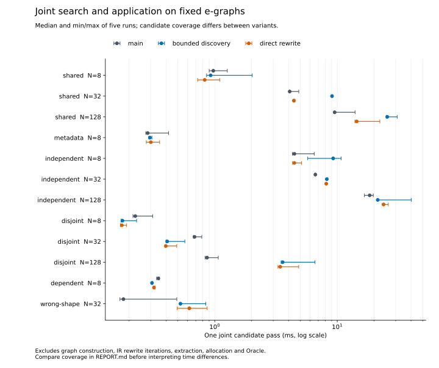

# ACT 다중 출력: 세 구현 비교

2026-10-26 측정 완료. **검색 제어와 후보 배분은 개선했고, 직접 rewrite 경로도 구현·검증했다.
그러나 main보다 전반적으로 빠르거나 더 좋은 코드를 만든다는 결과는 나오지 않았다.**
기본 14개 입력의 코드 비용은 세 방식이 같았고, 큰 triple 입력에서는 새 두 방식의
최대 RSS가 약 36% 늘었다. 직접 rewrite는 구조적 대안으로 유효하지만, 성능상 우월한
기본값으로 바로 대체할 근거는 이번 실험에 없다.

## 비교한 구현

| 브랜치 | 측정한 구현 커밋 | 실행 구성 |
| --- | --- | --- |
| `main` | `10f059e` | `multi-result` |
| `experiment/multipattern-discovery` | `05692e4` | `multipattern` |
| `experiment/multipattern-rewrite` | `3b85d5d` | `multipattern-rewrite` |

순서대로 기존 discovery를 보강하고 검증·커밋한 뒤, 그 상태에서 직접 rewrite 브랜치를
만들었다. `main`과 보강한 discovery 브랜치는 그대로 보존했다. 최종 체크아웃에서는
`--toolchain`으로 세 구현 모두를 다시 만들 수 있다. 비교 대상은 원래의 무제한에 가까운
discovery 실험 커밋이 아니라 **보강한 discovery**다.

빌드는 구현을 커밋하기 전에 동결했으므로 원본 manifest의 `repository_commit`은 당시의
부모 커밋이다. 이를 최종 구현 커밋으로 덮어쓰지 않았다. 대신 모든 적용 패치의 SHA-256이
위 커밋의 파일과 일치하는지 별도로 확인했다.
[source-provenance.json](results/source-provenance.json)에 그 대응과 upstream·patch·실행 파일
해시를 보관한다. 생성 소스와 런타임 파일의 전체 해시는 원본 build manifest에도 남아 있다.

## 무엇이 달라졌나

| 항목 | main | 보강한 discovery | 직접 rewrite |
| --- | --- | --- | --- |
| 공동 후보 검색 | 결과별 검색 후 조합 열거 | 실제 e-graph에서 MultiPattern 검색 | 생성된 rewrite의 Searcher에서 MultiPattern 검색 |
| tuple 생성 시점 | 후보 등록 | 후보 등록 | 전체 조건을 통과한 적용 시점 |
| ISA 적용 | tuple 패턴을 다시 검색 | tuple 패턴을 다시 검색 | 저장한 바인딩으로 검사·적용 |
| 검색 작업 한도 | tuple 한도에서 파생한 시도 한도 | refresh별 raw 결과·호출·시도 한도 | 컴파일 전체의 raw 결과·호출·시도 한도 |
| ISA별 기회 | 앞 ISA부터 조합 열거 | ISA를 번갈아 검색 | ISA별 고정 몫; 남은 몫은 넘기지 않음 |
| 후보/적용 한도 | canonical 후보 tuple 수 | 누적 tuple 등록 수 | 누적 유효 rewrite 적용 수 |

첫 단계의 세 요구는 [bounded-discovery 패치](../../patches/multipattern/act-backend/0002-bounded-discovery.patch),
[Probe ISA](ProbeISA.py), [고정 그래프 검사](discovery_probe.rs)에 구현했다.
남은 등록 한도만큼 유효 후보가 준비되면 검색을 멈춘다. 원시 결과를 다시 읽은 비용도
검색 예산에 포함한다. 시작 e-class는 ID 순서로 방문하고 ISA를 번갈아 검색한다.
공유 입력, 세 출력, 여러 공동 명령의 경쟁을 ISA 생성부터 실제 assembly 검증까지 연결했다.

직접 구현은 [generated-rewrites 패치](../../patches/multipattern-rewrite/act-backend/0001-generated-rewrites.patch)의
`get_rewrites_with_control → get_applier → JointRule` 경로다.
`MatchPlan`이 출력 순서와 의미 노드별 바인딩을 보존하고, `JointRule::search_anchors`가
생성된 형상·메타데이터·입력 조건을 검사한다. `apply_one`은 앞선 rewrite의 union으로
조건이 달라졌을 수 있으므로 적용 직전에 다시 검사한다. 성공한 뒤에만 tuple, ISA producer,
각 출력의 GTE를 연결한다. 개별 tensor 출력과 전체 producer를 잘못 합치지 않는다.

파이프라인에서 `Discovery` hook을 제거했지만 tuple 표현 자체를 제거하지는 않았다.
추출기가 tuple의 자식으로 명령의 출력 port를 찾기 때문이다. 검색·조건·적용을 하나의
rewrite에 묶는다는 점에서 이 저장소의 ACT rewrite 흐름에 더 직접적으로 들어간다.
이 구조적 평가는 실행 시간 향상과 별개의 판단이다.

`DirectScheduler`는 이미 구현된 후보만 나온 첫 검색 구간 때문에 새 후보를 보기 전에
saturation으로 종료되는 일을 막는다. 다중 출력 예산을 소진해도 단일 출력·IR rewrite는
계속 실행한다. 직접 구현의 한도는 ISA에 균등 분배하고 정수 나머지를 선언 순서로 준다.
이는 앞 명령의 독점을 막지만, 일치하지 않는 ISA의 남은 예산을 활용하지 못한다.

## 기능 검증

| 검사 | main | 보강한 discovery | 직접 rewrite |
| --- | --- | --- | --- |
| 기존 회귀 검사 그룹 | 10/10 | 10/10 | 10/10 |
| Python 생성기 검사 | 51/51 | 51/51 | 51/51 |
| Rust 실행 수: QKV / DoubleGEMM | 29 / 20 | 48 / 39 | 54 / 51 |
| 새 Probe ISA의 HLO 입력 | 14/14 | 14/14 | 14/14 |
| 고정 그래프 시나리오 | 12/12 | 12/12 | 12/12 |

Rust 실행 수에는 두 생성 대상에서 중복 실행한 공통 library 테스트가 포함된다.
직접 구현은 새 core 테스트 6개와 [통합 테스트 6개](../../tests/rust/direct_rewrite.rs)를 포함한다.
검색이 그래프를 바꾸지 않는지, 거절된 후보가 적용 몫을 소모하지 않는지, 결과 순서와
반복 결과, 검색 이후 union, 입력 의존성, 예산 소진 시 단일 명령 대체, 한 producer의
두 출력 추출을 검사했다. all-identity 패턴, 공유·반복 피연산자와 중첩 메타데이터도 검사한다.
identity 출력과 연산 출력을 함께 가진 실제 ISA의 별도 end-to-end 예제까지 포함한 것은 아니다.

Probe의 산술 명령은 `add(x,a), multiply(x,b)`와
`add(x,a), multiply(x,b), dot(x,c)`이다. 별도의 `reshape_pair`도 함께 선언했다.
각 HLO를 seed0·seed1·seed2·zero 입력으로 실행하고, 모든 출력의 dtype·shape·바이트가
원래 HLO와 동일하고 유한한지 확인했다. 선택된 PII와 할당 기록으로 출력 port·주소·수명을
검사했다. 작은 양성 예제에는 의도한 공동 명령이 실제로 선택되어야 한다는 검사도 있다.

공동 한도 0의 concat 입력은 세 구성 × 두 입력, 총 6/6 검증을 통과했다.
한도 2, raw·호출·시도 한도 각 16의 세 입력도 총 9/9 통과했다.
예산을 줄여 단일 명령으로 대체된 경우는 정확성 실패와 최적화 품질 저하를 구분했다.

## 측정 조건

- 같은 ISA/HLO·네 입력 데이터셋·upstream·cost model을 사용한다.
- Intel Core i7-13700, Linux x86-64, ACT Conda 환경에서 빌드와 다른 테스트를 멈추고
  컴파일러를 하나씩 실행한다. CPU affinity는 0–23이며 전용 CPU에 고정하지 않았다.
- 입력마다 준비 실행 1회와 측정 5회. 반복마다 세 구성의 실행 순서를 순환한다.
  준비 실행과 실패 기록도 버리지 않는다.
- 기본 측정은 14 입력 × 3 구성 × 6회. 고정 그래프는 12 시나리오 × 3 구성 × 6회.
  작은 예산 측정은 concat 두 입력과 reshape 한 입력 × 3 구성 × 6회다.
- 컴파일 wall time은 프로세스 시작부터 종료까지이며 생성·빌드·Oracle 검증은 제외한다.
  RSS는 GNU time의 `%M`이다. 고정 그래프 내부 시간은 그래프 구성·추출·할당·Oracle을 제외한다.
- ACT 내부 시간 예산은 기존 10초, 외부 컴파일 프로세스 timeout은 35초다.
  고정 그래프 외부 timeout은 15초다.
- 기본 숫자는 공동 한도 64, raw·호출·시도 각 4096이다. 작은 예산은 2와 각 16이다.
  **한도의 의미와 적용 범위가 다르므로 같은 숫자가 같은 검색 작업량을 뜻하지 않는다.**
- 현재 `model_cost`는 assembly 줄 수다. 하드웨어 실행 시간이나 에너지 개선을 측정한 실험이 아니다.

한 번의 egg 검색이나 생성된 precondition 내부를 중간 취소하지는 못한다. 내부 deadline은
호출 사이에서 확인하는 방식이며, 엄격한 상한은 외부 프로세스 timeout으로 둔다.
`ACT_DISCOVERY`는 refresh별 카운터이고 `ACT_DIRECT_REWRITE`는 누적 카운터다.
직접 구현은 마지막 레코드를 사용한다. `complete`는 마지막 검색 스냅샷의 상태다.
기존 종료 hook이 프로세스를 먼저 끝내면 `runner_stop`은 null일 수 있다.

## 반복 측정 결과

전체 컴파일 기본 252/252회, 작은 예산 54/54회가 수치·할당 검증을 통과했다.
고정 그래프 216/216회도 의미·출력 순서 검사를 통과했다. 준비 실행을 제외하면 각각
210회, 45회, 180회다. timeout이나 compiler 실패는 없었다.

### 전체 컴파일: 같은 비용, 보편적인 속도 개선 없음

시간은 초 단위 중앙값 `[최소–최대]`이다. 비용과 API 호출 수는 세 구성 및 각 5회 측정에서
모두 같아 한 열로 표시한다. 호출 종류나 주소 배치까지 같다는 뜻은 아니다.

| 입력 | main 시간 | discovery 시간 | direct 시간 | 비용 / API 호출 |
| --- | ---: | ---: | ---: | ---: |
| `shared_pair_tuple` | 0.171 [0.042–0.178] | 0.171 [0.038–0.181] | 0.040 [0.039–0.178] | 32 / 6 |
| `shared_pair_concat` | 0.041 [0.039–0.090] | 0.042 [0.038–0.047] | 0.042 [0.038–0.043] | 30 / 5 |
| `shared_triple_tuple` | 9.897 [9.805–10.023] | 9.995 [9.786–10.015] | 9.869 [9.755–10.019] | 36 / 8 |
| `shared_triple_concat` | 0.055 [0.051–0.061] | 0.054 [0.047–0.057] | 0.054 [0.047–0.062] | 32 / 6 |
| `different_pair_inputs` | 0.037 [0.032–0.038] | 0.035 [0.032–0.041] | 0.033 [0.032–0.040] | 35 / 8 |
| `dependent_pair` | 0.032 [0.030–0.042] | 0.038 [0.033–0.039] | 0.034 [0.029–0.037] | 31 / 6 |
| `repeated_pair_input` | 0.086 [0.084–0.091] | 0.086 [0.083–0.086] | 0.089 [0.082–0.090] | 30 / 5 |
| `mixed_pair_triple` | 10.022 [10.022–10.024] | 10.026 [10.023–10.032] | 10.024 [10.022–10.027] | 48 / 15 |
| `shared_reshape` | 0.584 [0.579–0.598] | 0.584 [0.581–0.595] | 0.582 [0.570–0.594] | 28 / 4 |
| `different_reshape_inputs` | 0.050 [0.047–0.056] | 0.048 [0.046–0.052] | 0.048 [0.047–0.051] | 31 / 6 |
| `shared_pairs_4` | 10.023 [10.020–10.025] | 10.027 [10.022–10.030] | 10.024 [10.019–10.027] | 66 / 25 |
| `shared_pairs_16` | 10.032 [10.020–10.037] | 10.030 [10.027–10.039] | 10.031 [10.030–10.036] | 211 / 110 |
| `shared_triples_4` | 10.023 [10.020–10.029] | 10.025 [10.023–10.031] | 10.023 [10.021–10.026] | 87 / 38 |
| `shared_triples_16` | 10.045 [10.028–10.055] | 10.043 [10.025–10.052] | 10.045 [10.029–10.051] | 292 / 159 |

`shared_pair_tuple`은 약 0.04초와 0.17초로 갈린다. 추출한 PII도 19개 또는 121개로
달라졌다. direct의 중앙값만 보고 약 4배 빨라졌다고 일반화할 수 없다.
`shared_triple_tuple`의 한 direct 실행은 비용 36의 코드를 약 0.74초에 찾고도
1,922개 assembly 후보를 평가했다. 큰 입력의 약 10초는 공동 검색 시간 자체가 아니라
기존 종료 정책과 추출·할당·평가를 포함한 전체 시간이다.

`shared_pairs_16`에서는 새 두 방식 모두 공동 후보/적용 16개를 준비했지만 최종 코드는
`shared_pair` 두 개만 사용했다. `shared_triples_16`은 main이 pair 하나, 새 두 방식이
triple 하나를 선택했지만 총 산술 호출 수는 모두 47개, 전체 API 호출 수는 159개였다.
따라서 후보 배분 개선이 이 입력들의 최종 비용 개선으로 이어졌다고 할 수 없다.

대표 입력의 최대 RSS 중앙값은 다음과 같다. 단위는 MiB이며 전체 값은 CSV에 있다.

| 입력 | main | discovery | direct |
| --- | ---: | ---: | ---: |
| `shared_pair_concat` | 28.30 | 28.38 | 28.44 |
| `shared_triple_tuple` | 41.31 | 41.29 | 41.50 |
| `mixed_pair_triple` | 223.61 | 220.83 | 222.50 |
| `shared_pairs_16` | 237.38 | 235.02 | 236.59 |
| `shared_triples_4` | 273.54 | 273.23 | 273.95 |
| `shared_triples_16` | 210.68 | 286.09 | 287.95 |

**`shared_triples_16`의 메모리 증가는 뚜렷하다.** main의 반복 범위는 208.40–212.77MiB,
discovery는 280.55–288.30MiB, direct는 285.66–288.25MiB였다.
중앙값 기준 각각 +35.8%, +36.7%다. 같은 비용의 코드를 만들면서 더 많은 메모리를 썼다.
어느 자료구조가 증가분을 차지했는지 heap profiling으로 분해한 것은 아니다.

### 고정 그래프: 후보 다양성은 개선, 시간은 상황에 따라 다름

아래 숫자는 적용된 joint producer 수이며 `pair / triple` 순서다. tensor 출력 수가 아니다.
각 수치는 측정 5회에서 동일했다. `shared`는 공유 입력 제약이 있고,
`independent`는 그 제약이 없어 가능한 조합이 N²/N³으로 늘어난다.

| 그래프 | main | discovery | direct |
| --- | ---: | ---: | ---: |
| shared 8 | 8 / 8 | 8 / 8 | 8 / 8 |
| shared 32 | 32 / 3 | 32 / 32 | 22 / 21 |
| shared 128 | 32 / 0 | 32 / 32 | 22 / 21 |
| independent 8 | 64 / 0 | 23 / 41 | 32 / 32 |
| independent 32 | 64 / 0 | 32 / 32 | 32 / 32 |
| independent 128 | 64 / 0 | 32 / 32 | 32 / 32 |

main은 shared 32에서 pair 조합에 1,024번의 시도를 쓰고, 남은 한도로 triple 일부만 찾는다.
shared 128에서는 4,096번의 시도가 pair 단계에서 끝난다. 보강한 discovery는 ISA를 번갈아
검색해 두 종류에 기회를 준다. shared 128에서 원시 결과 126개(재검색 62개 포함),
검색 호출 502회로 유효 후보 64개를 준비한 뒤 멈췄다.

direct의 43개는 고정 배분의 결과다. 적용 한도 64가 pair 22, triple 21, reshape 21로
나뉘고 이 산술 그래프에는 reshape가 없다. 남는 21개 몫을 재분배하지 않는다.
같은 사례에서 direct는 원시 결과 43개, 검색 호출 293회로 43개를 적용했다.
검색량과 후보 수가 다른 이 두 실행을 단순 속도 비교로 해석하지 않는다.

한 번의 공동 후보 검색·적용 시간 중앙값은 다음과 같다. 단위는 ms다.

| 그래프 | main | discovery | direct |
| --- | ---: | ---: | ---: |
| shared 8 | 0.973 | 0.925 | 0.828 |
| shared 32 | 4.090 | 9.061 | 4.423 |
| shared 128 | 9.527 | 25.607 | 14.415 |
| metadata 8 | 0.283 | 0.296 | 0.301 |
| independent 8 | 4.466 | 9.263 | 4.463 |
| independent 32 | 6.627 | 8.220 | 8.134 |
| independent 128 | 18.393 | 21.413 | 23.858 |
| disjoint 8 | 0.225 | 0.176 | 0.174 |
| disjoint 32 | 0.684 | 0.409 | 0.399 |
| disjoint 128 | 0.865 | 3.586 | 3.422 |
| dependent 8 | 0.346 | 0.308 | 0.319 |
| wrong-shape 32 | 0.180 | 0.525 | 0.620 |



동일한 전체 후보를 찾는 shared 8은 세 방식 모두 pair 8개와 triple 8개를 구현한다.
direct의 중앙값은 main보다 약 15% 작지만 반복 범위가 겹친다. metadata 8에서는
모두 reshape pair 8개를 구현하며 direct가 약 6% 느렸다. 보편적인 속도 향상은 아니다.

independent 32/128은 discovery와 direct가 각각 pair 32개와 triple 32개를 구현한다.
128에서는 direct가 discovery보다 약 11% 느렸다. 이 비교도 선택된 개별 바인딩까지
같다는 검증은 아니다. main은 총 64개라도 모두 pair이므로 동일한 작업으로 취급하지 않는다.

disjoint 128은 세 방식의 결과가 모두 0개여도 검색 종료 범위가 다르다. main은 한도에서
조합 열거를 자를 수 있다. 원시 결과가 0이라는 사실도 검색 내부 비용이 0임을 뜻하지 않는다.
wrong-shape 32처럼 결과가 모두 0개인데 새 방식이 더 느린 사례도 있다.

### 작은 예산: 정확한 대체 실행과 코드 품질 저하

공동 한도 2, raw·호출·시도 각 16에서 얻은 결과다. 시간은 초 단위 중앙값이며
코드 비용과 호출 수는 각 구성의 5회 측정에서 동일했다.

| 입력 | main 시간 / 비용 / 호출 | discovery 시간 / 비용 / 호출 | direct 시간 / 비용 / 호출 |
| --- | ---: | ---: | ---: |
| `shared_pair_concat` | 0.039 / 30 / 5 | 0.043 / 30 / 5 | 0.041 / 30 / 5 |
| `shared_triple_concat` | 0.057 / 32 / 6 | 0.056 / 32 / 6 | 0.056 / 32 / 6 |
| `shared_reshape` | 0.592 / 28 / 4 | 0.597 / 28 / 4 | 0.144 / 29 / 5 |

direct의 reshape 적용 몫은 0이다. 측정 5회 모두 `reshape_pair`를 선택하지 못하고
단일 reshape 두 개로 대체했다. 모든 수치·할당 검증은 통과했지만 비용이 28에서 29로
늘었다. 약 0.144초로 빨라진 것은 같은 품질의 최적화 속도 향상이 아니다.

### 재현 범위와 다음 판단

고정 그래프의 규칙별 후보 수는 반복마다 같았고, 제한된 동일 스냅샷의 선택 정책은
단위 테스트로 확인했다. 하지만 전체 compiler의 바이트 단위 재현성을 달성한 것은 아니다.
예를 들어 pair concat은 명령과 비용이 같아도 피연산자의 scratch 주소가 바뀐다.
main을 포함한 세 구성 모두에서 나타났으며 모든 결과는 Oracle·할당 검증을 통과했다.

직접 rewrite는 후보 tuple의 재검색을 없애고 검증과 적용의 책임을 명확하게 묶었다.
그 대신 바인딩 보존, ISA별 예산 상태, 중복 제거, scheduler 진행 보장이 필요해 코드가
단순히 짧아진 것은 아니다. 지금 상태는 비교 가능한 검증된 실험 구현이며, 모든 ACT 입력에
대한 성능 우위를 증명한 결과는 아니다.

후속 개선 우선순위는 **남은 ISA 몫의 재분배와 작은 예산의 기회 보장**,
**큰 triple 입력의 메모리 증가 원인 분해**, **발견한 공동 후보가 최종 선택으로 이어지는
추출·평가 과정**이다. 이번에는 세 비교 구현의 경계를 유지하기 위해 추출기를 바꾸지 않았다.

## 재현과 증거

재현 명령은 [실험 README](README.md)에 있다. 전체 기능 검증은 다음과 같다.

```bash
conda activate act
./scripts/test.sh
./scripts/test.sh --toolchain multipattern
./scripts/test.sh --toolchain multipattern-rewrite
```

작업 공간의 원본 증거는 `build/goal-multipattern/`에 보관한다.
`reference/`, `stage1/full-regression/`, `stage2/full-regression/`에 회귀 로그가 있고,
`probe/`와 `independent/`에는 동결한 소스·compiler·Oracle·ISA/HLO·build manifest가 있다.
`probe/checks/`에는 기능 검사, `probe/measurements/`에는 전체 컴파일 반복 측정,
`micro/measurements/`에는 고정 그래프 반복 측정이 있다.
동결한 compiler는 생성 당시의 런타임 파일 경로를 사용하므로 실행 파일만 옮겨서는 안 된다.

Git에 함께 보관한 증거:

- [compiler-samples.csv](results/compiler-samples.csv): 전체 컴파일 306회.
- [micro-samples.csv](results/micro-samples.csv): 고정 그래프 216회.
- [aggregate.json](results/aggregate.json): 설정, 요약 통계, build manifest, 검사 요약.
- [raw-results.json.gz](results/raw-results.json.gz): 위 반복 측정과 기능 검사 93회의 전체
  샘플 레코드. 준비 실행·정확한 입력별 검증 결과·검색 보고서도 포함한다.
- [source-provenance.json](results/source-provenance.json): 세 구현 커밋과 실제 측정 소스의 대응.
- [measurement-validation.json](results/measurement-validation.json): 검색 보고서 1,654개와
  직접 rewrite 보고서 334개의 raw·호출·시도·적용 한도 감사. 위반은 없었다.

```bash
python -B experiments/multipattern/export_results.py \
  --root build/goal-multipattern --output experiments/multipattern/results
python -B experiments/multipattern/plot_results.py
```

Exporter는 완료 시각과 전체 샘플 행렬을 검사해 일부 결과만으로 보고서를 내보내지 못하게 한다.
원본과 요약의 중앙값·최소·최대·개수는 별도 검토에서 재계산해 일치함을 확인했다.
실험 코드와 보고서를 수정하는 경우, 동결한 컴파일러의 source fingerprint와 후보/적용 한도의
의미를 유지하거나 새로운 결과 디렉터리와 측정 이름을 사용해야 한다.
