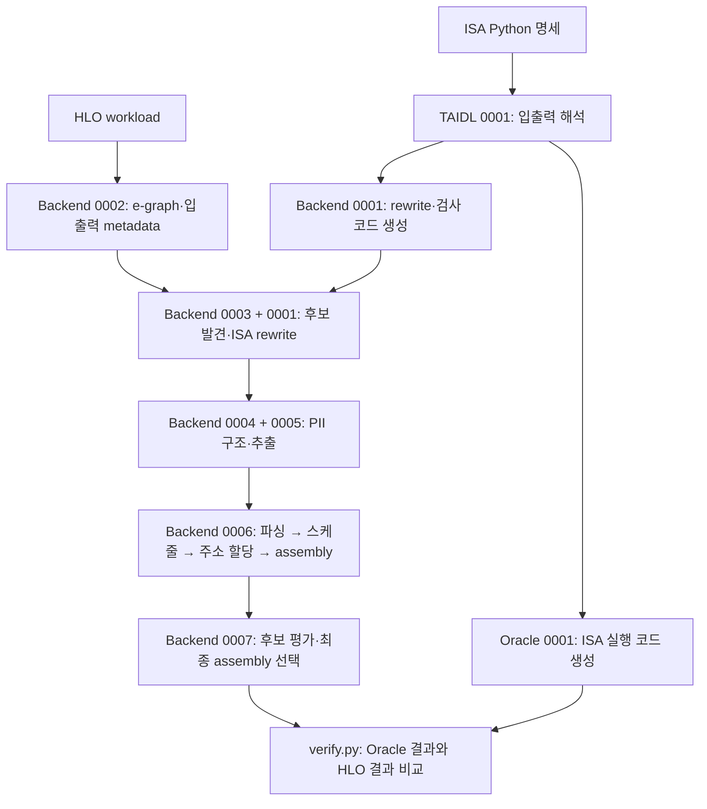

# multi-result: 현재 다중 결과 지원

[인수인계](../../handoff/README.md) · [전체 구성](../../handoff/README.md#5-패치-폴더는-각각-무엇인가) · [적용 목록](series)

독립 계산들을 하나의 ISA 명령 후보로 찾고, 그 명령이 내는 여러 값을 추출·할당·실행까지
보존한다. BF16 DoubleGEMM과 MultiPattern 비교의 바탕이다.
**고정 upstream → baseline → multi-result** 순서로 적용하며 TAIDL 1개, Backend 7개, Oracle 2개다.
Gemmini를 보존한 `multi-result-legacy`와는 별도 구현이다.

대표 경로는 [QKVDoubleGemm.py](../../cases/double_gemm/QKVDoubleGemm.py)의 두 결과 명세 →
일반 `dot` 두 개에서 공동 후보 발견 → 결과별 PII 참조 → C++ 주소 할당 → `double_gemm` 호출문이다.
명령 생산자는 한 번 선택하고 각 결과는 따로 참조한다. 두 결과를 같은 tensor로 합치거나
생산자를 결과마다 다시 실행하지 않는 것이 핵심 조건이다.

## 개별 패치와 처리 흐름

패치의 하위 폴더는 **실제 수정할 upstream 저장소**를 뜻하고, 번호는 그 저장소 안의 적용 순서다.
명세를 읽는 첫 단계는 세 저장소에 걸쳐 있으므로 각각 `0001`이 있다. 역할을 구분할 수 있도록
파일명도 아래처럼 나눴다.

| 패치 | 수정하는 코드와 역할 |
| --- | --- |
| [TAIDL 0001 — semantic-interface](taidl/0001-semantic-interface.patch) | tuple 반환 문법과 `semantic_interface()`. `parameter(index)`로 입력 순서, ROOT tuple로 결과 순서를 읽고 개수·타입을 확인한다. |
| [Backend 0001 — isa-rewrites](act-backend/0001-isa-rewrites.patch) | 그 입출력 해석을 받아 `lower_semantics()`로 계산식을 읽고, IR→ISA 규칙·타입/shape 검사·외부 입력 검사를 생성한다. |
| [Oracle 0001 — isa-codegen](act-oracle/0001-isa-codegen.patch) | 같은 입출력 해석을 받아 `generate_inputs()`·`generate_outputs()`가 Oracle의 읽기·결과 저장 코드를 생성한다. |

입출력 순서를 정하는 함수는 TAIDL에 한 번 정의하며 Backend와 Oracle이 함께 호출한다.
Backend는 **어떤 계산을 ISA로 바꿀 수 있는지**, Oracle은 **그 ISA를 실행했을 때 어떤 값이
나오는지**를 담당하므로 두 생성기의 출력물은 서로 다르다.

다중 출력 Backend의 7개 패치는 다음 흐름으로 이어진다.

| 단계 | 패치 | 책임과 주요 코드 |
| --- | --- | --- |
| ISA 규칙 준비 | [0001-isa-rewrites](act-backend/0001-isa-rewrites.patch) | `semantics.py`, rewrite 생성기, `applier.rs`, `joint.rs`. 규칙에 필요한 `TensorOp` tuple/GTE와 tensor 정보 처리도 포함한다. |
| HLO 입력 처리 | [0002-hlo-tuples](act-backend/0002-hlo-tuples.patch) | `initializer/`, `ir/value.rs`, `metadata.rs`. HLO tuple/GTE를 읽고 프로그램의 입력·반환 구조와 HBM 위치를 만든다. |
| ISA 후보 발견 | [0003-isa-candidates](act-backend/0003-isa-candidates.patch) | `discovery.rs`와 Runner hook. 결과별 매칭을 다시 찾아 적합한 조합에 tuple/GTE를 추가한다. ISA 노드는 0001의 rewrite로 추가한다. |
| PII 표현 | [0004-pii-model](act-backend/0004-pii-model.patch) | `BufferSignature`, `ValueRef`, `PiiResult`, `PiiGraph`. 명령어 하나의 여러 결과, 소비자의 결과 참조, 프로그램 출력을 기록한다. |
| PII 추출 | [0005-pii-extraction](act-backend/0005-pii-extraction.patch) | `extractor/fast.rs`, `slow.rs`, `utils.rs`. 요구한 값의 생산자·결과를 선택하고, 재사용과 실패 시 복구를 처리한다. |
| PII → assembly | [0006-pii-to-assembly](act-backend/0006-pii-to-assembly.patch) | C++ parser·Instruction/Tensor·scheduler·allocator·emitter와 생성기. 결과별 주소·수명을 계산해 호출문과 할당 기록을 쓴다. |
| 최종 후보 선택 | [0007-candidate-evaluation](act-backend/0007-candidate-evaluation.patch) | `pipeline.rs`의 종료 판단. 받은 PII batch에 미평가 후보가 있으면 ‘개선 없음’ 중단을 보류하며 전체 시간 제한은 유지한다. |

실험 구성의 [Backend 0001 — direct-discovery](../multipattern/act-backend/0001-direct-discovery.patch)는
위 7개 패치 다음에 적용하며 `discovery.rs`의 검색 부분을 바꾼다. 연산자마다 새 child 변수를 둔
얕은 패턴과 입력 동등성 조건으로 공동 검색을 구성해, metadata wildcard를 보존한다.
기본 `multi-result`는 이 패치를 적용하지 않는다.

Oracle의 [0002-hlo-tuples](act-oracle/0002-hlo-tuples.patch)는 생성된 kernel의
입력 tuple을 tensor 목록으로 펼치고 결과를 원래 tuple 구조로 복원한다. ISA 한 명령어의 결과
port 순서를 다루는 Oracle 0001과 구분한다.

패치 경계는 각 기능이 다음 단계에 넘기는 정보를 기준으로 정했다. `pipeline.rs`는 여러 단계를
연결하므로 여러 패치가 수정한다. 0002는 입출력 metadata, 0003은 발견 hook, 0005는 추출기의
입력 인자, 0006은 C++ 호출·산출물 전달, 0007은 종료 조건을 바꾼다.

0001의 `initializer` 수정은 생성한 의미 검사와 workload의 연산 정보를 맞추기 위한 것이다.
scalar의 빈 shape, broadcast의 `dimensions`, multiply의 IR 처리가 여기에 포함된다.
HLO의 중첩 tuple·프로그램 입출력 구조를 읽는 기능은 0002에 둔다. Oracle 0001에도 명세 본문의
concatenate와 scalar를 실행 코드로 만드는 수정이 포함된다.

0004의 fast/slow 수정은 새 자료구조를 기존 단일 출력 추출기에 연결하는 부분이다.
다중 결과를 따라가는 탐색은 0005에 있다. 0004에서 넣은 임시 차단은 아직 구형인 C++ allocator에
다중 출력 PII를 넘기지 않도록 하며, C++ 지원을 완성하는 0006이 제거한다.
0006은 PII의 여러 결과를 C++에서 읽어 assembly까지 보존하는 범위여서 parser·scheduler·emitter도
함께 수정한다.

공통 외부 입력 검사는 0001의 `joint.rs`에 정의하고 0003도 그 구현을 호출한다. 후보를 처음 찾을 때의
선별과 실제 ISA rewrite가 매칭한 조합의 검사는 각각 수행한다. e-graph가 바뀌거나 workload에서
tuple이 직접 들어오는 경우에도 현재 매칭을 확인해야 하기 때문이다.

## 적용된 구현을 읽거나 수정할 때

위 코드 이름은 각 upstream 내부 경로다. 예를 들어 `discovery.rs`의 전체 적용 결과는
`build/multi-result/src/act-backend/act_backend/generic/src/isel/discovery.rs`에서 읽는다.
[소스 준비와 변경 보존](../../README.md#패치가-적용된-소스-읽기와-수정)을 따라 준비하고,
수정한 기능에 맞는 패치에 변경을 남긴다. `third_party/`의 고정 원본은 그대로 유지한다.

입출력 순서를 바꾸면 TAIDL·Backend·Oracle을 함께 확인한다. 결과 표현을 바꾸면 Rust PII와
C++ parser·할당·emitter까지 확인해야 한다. 결과 하나만 사용하는 경우, 결과의 다른 사용 시점,
생산자 재사용, 서로 의존하는 계산의 잘못된 묶음도 확인 대상이다.
주소·수명과 수치 검증은 [기존 검사](../../README.md#선택-사항-명령-묶어서-실행하기와-회귀-테스트)를 사용한다.

현재 `lower_semantics()`는 표준 행렬곱의 의미를 다루며 상수·`minimum`·`maximum`의 일반적인
명세 변환은 지원하지 않는다. legacy Gemmini의 정수 포화 명세를 가져오려면 이 부분을 맞춰야 한다.
이 패치 묶음 자체가 엔진 실행시간 모델이나 일반적인 비동기 스케줄러를 추가하는 것은 아니다.
